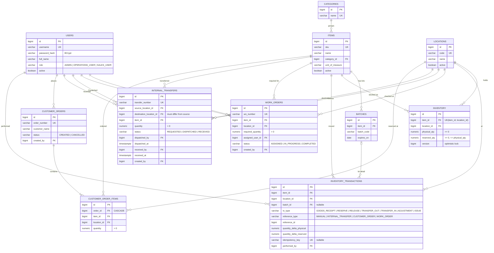

# Entity–Relationship Diagram

Matches `backend/src/main/resources/db/migration/V1__schema.sql` exactly.
Mermaid source: [`er-diagram.mmd`](er-diagram.mmd).

## Cardinality notes

- One inventory row per `(item, location)` pair — enforced unique; quantity fields carry the stock state.
- `inventory_transactions` is append-only; every mutation of `inventory` writes a ledger row in the same transaction.
- A work order references exactly one item/location and its required quantity; shortage is derived, never stored.
- Transfer `source_location_id <> destination_location_id` is a DB CHECK constraint.
